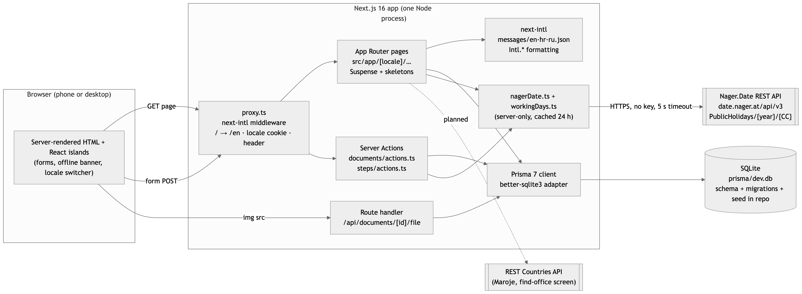
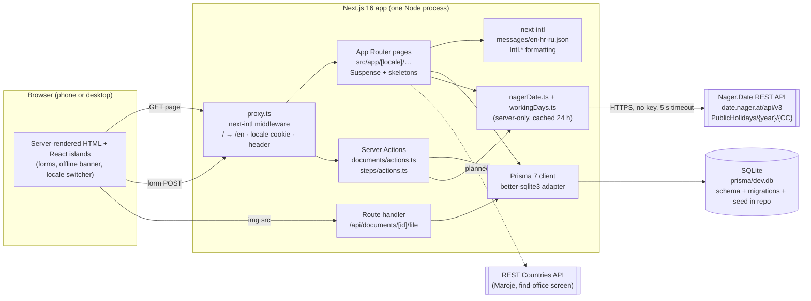

# 2. Architecture and technology

## 2.1 Stack

| Layer | Technology and version | Why this choice |
|---|---|---|
| **Frontend** | Next.js 16.4 (App Router, React 19.3, TypeScript 5), Tailwind CSS 4.3 | One framework renders the pages on the server and ships only small client islands (forms, offline banner, locale switcher), which keeps the mobile-first screens fast on a phone. Server Components let every screen read the database directly without a separate API layer. Tailwind gives shared 44 px targets and focus rings through one class string (`src/lib/ui.ts`). |
| **Backend / API** | Next.js 16 Server Actions, Route Handlers and the `proxy.ts` middleware, Node.js 22 | The same process serves pages, handles form posts (create / edit / delete a document, change a step status, vote on a correction) and streams uploaded scans from `/api/documents/[id]/file`. Nothing user-facing talks to a third party from the browser. |
| **Database** | SQLite 3 through Prisma 7.10 with the `better-sqlite3` driver adapter | Zero-setup for a reviewer (`npm run db:migrate && npm run db:seed`), file-based so the seed state is reproducible, UTF-8 by default. Prisma gives migrations, a typed client and a one-line switch to PostgreSQL for deployment. |
| **i18n library** | next-intl 4.15 (ICU MessageFormat, `Intl.*` under the hood) | Locale in the URL (`/en`, `/hr`, `/ru`), real plural rules, `Intl.DateTimeFormat` / `NumberFormat` / `ListFormat` / `RelativeTimeFormat` exposed through one `useFormatter()`, strict TypeScript typing of message keys so a hardcoded or misspelled string fails the build. |
| **Testing** | Node.js built-in test runner via `tsx` (`npm test`); axe-core 4.14 and Playwright for the accessibility evidence | The working-day arithmetic behind the waiting screen is pure and unit-tested (weekends, a public holiday, zero days, negative input). The browser checks are scripted so they can be re-run before each release. |
| **CI / automation** | ESLint 9 with `eslint-config-next` and the React Compiler rules, `tsc --noEmit`; `npm run build` must pass before a PR is opened | No hosted CI yet; branch protection on `main` requires a reviewed pull request. |
| **Hosting** | None (local only) | A free Postgres + Vercel deployment is possible via `DATABASE_URL`, but was not a requirement. |

## 2.2 Architecture diagram

*Figure 2.1 — system architecture (source: `figures/architecture.mmd`)*

How a request flows: the browser asks for `/hr/journeys/…/steps/…`; `proxy.ts` validates the
locale segment, stores it in the `NEXT_LOCALE` cookie and forwards an `X-NEXT-INTL-LOCALE` header;
the page component loads the messages for that locale, reads the journey, step, attached documents
and corrections through Prisma, asks `nagerDate.ts` for the public holidays of the journey's
country (served from the 24-hour cache after the first call) and streams the HTML. The parts that
need the database are wrapped in `<Suspense>` with a localised loading skeleton, so the static
shell (header, navigation, locale switcher) arrives first. Form submissions go to Server Actions in
the same process, which write through Prisma, call `revalidatePath` and redirect.

## 2.3 Repository structure

| Folder / file | What lives there |
|---|---|
| `src/app/[locale]/` | Every screen, one folder per route: `documents/` (wallet, screens 11–14), `journeys/[journeyId]/steps/` (overview and step detail, screens 15–19), `journeys/[journeyId]/complete/` (screen 20), `dev/i18n/` (formatting and plural evidence page). Each route folder keeps its own `actions.ts` (Server Actions) and, where needed, `error.tsx` and `not-found.tsx`. |
| `src/app/api/` | Route handlers; today only `documents/[id]/file` which serves an uploaded scan. |
| `src/app/layout.tsx`, `src/app/[locale]/layout.tsx`, `globals.css` | Root HTML with `lang` and `dir`, the skip link, header navigation, offline banner, fonts (Inter with Latin-Extended and Cyrillic subsets). |
| `src/components/` | Shared client and server components: `DocumentForm`, `ConfirmDelete` (native `<dialog>`), `SubmitButton` (pending and offline aware), `OfflineBanner`, `LoadingSkeleton`, `StatusBadge`, `LocaleSwitcher`, `CorrectionForm`, `JourneyShortcuts`. |
| `src/lib/` | Framework-free logic: `workingDays.ts` (+ tests), `nagerDate.ts` (external API client), `catalog.ts` (typed access to catalogue translations), `stepStatus.ts`, `documentFiles.ts` (upload limits), `ui.ts` (shared class strings), `db.ts` (Prisma singleton), `time.ts`. |
| `src/i18n/` | next-intl configuration: `routing.ts` (locales, default, RTL set), `request.ts` (locale from the root param, message loading with en fallback), `navigation.ts` (locale-aware `Link`/`redirect`), `actionLocale.ts` (locale inside Server Actions). |
| `src/proxy.ts` | The next-intl middleware (Next 16 name for middleware). |
| `src/hooks/` | `useOnline` (navigator online state through `useSyncExternalStore`). |
| `messages/` | `en.json` (source), `hr.json`, `ru.json`; 213 keys each, nested by screen and by catalogue id. |
| `prisma/` | `schema.prisma`, `migrations/` (one migration per schema change, applied with `prisma migrate deploy`), `seed.ts`, and the ignored `dev.db`. |
| `src/generated/prisma/` | The generated Prisma client (created on `npm install`, not committed). |
| `docs/part-b/` | This document's drafts and figures. |
| `public/` | Static assets (favicon only). |
| `.env.example`, `prisma.config.ts`, `next.config.ts`, `eslint.config.mjs`, `tsconfig.json` | Configuration. `.env` is ignored; `DATABASE_URL` and the optional `NAGER_DATE_BASE_URL` come from it. |
