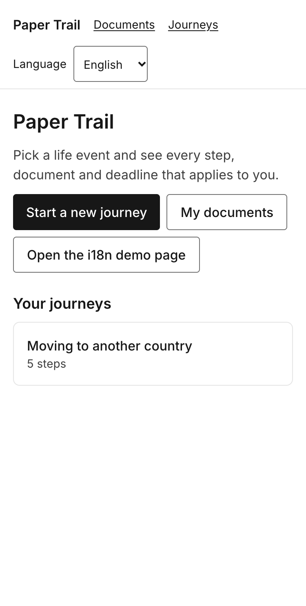
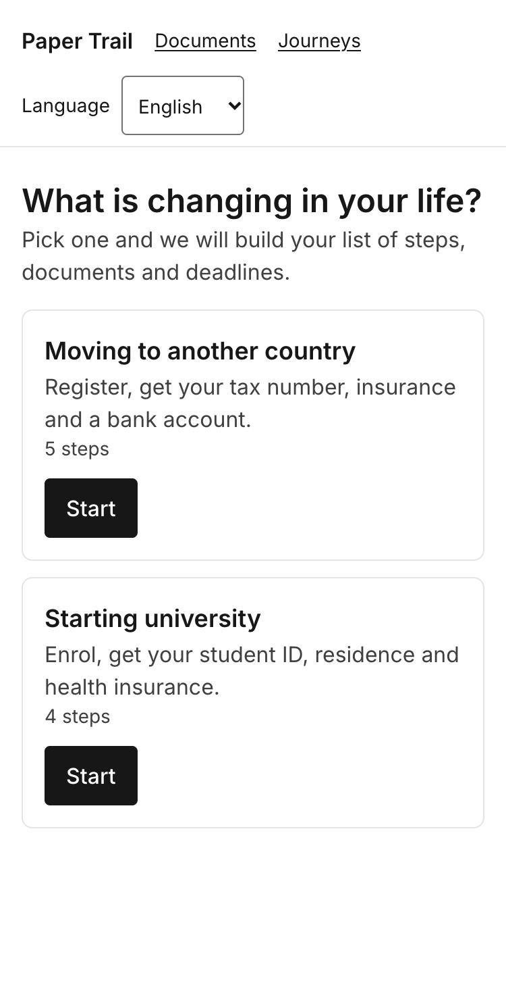
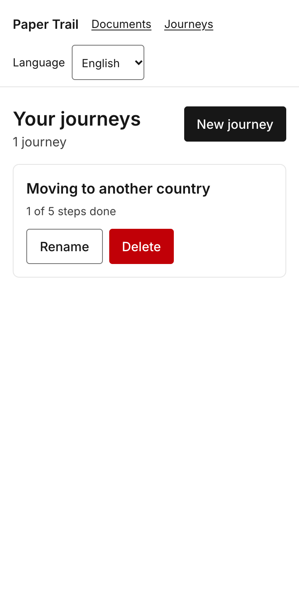
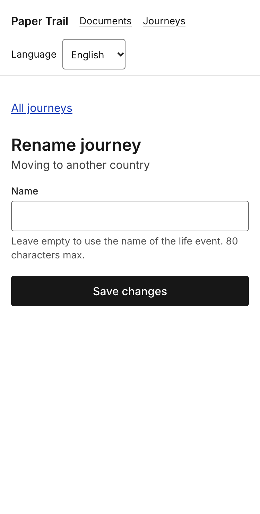
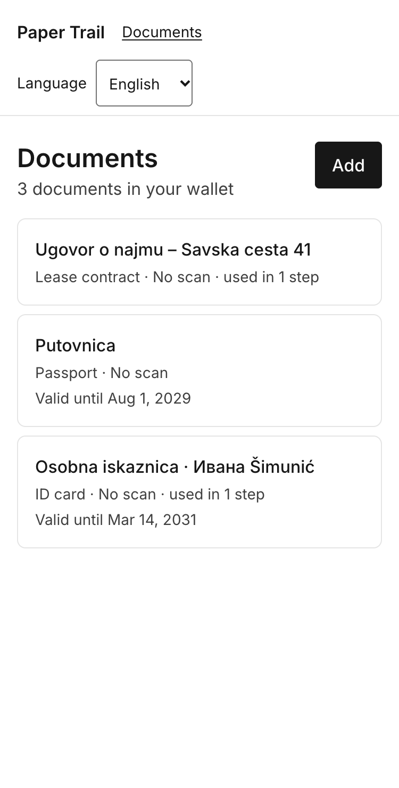
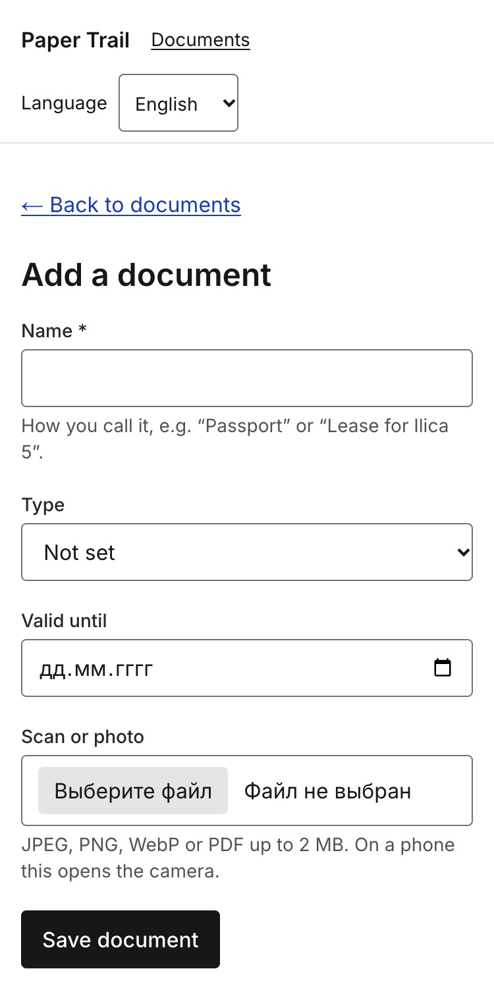
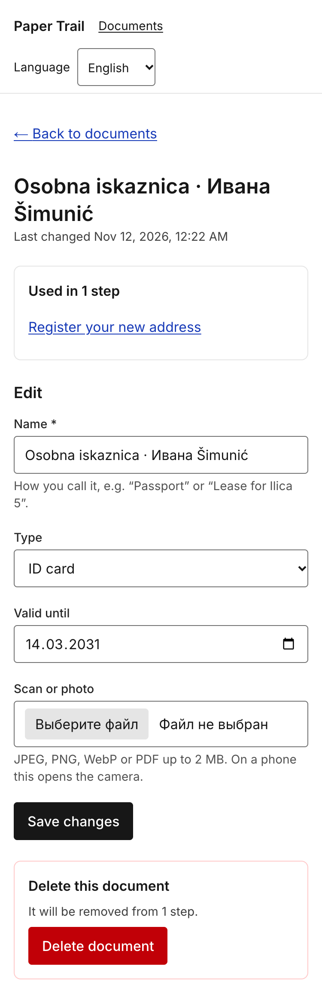
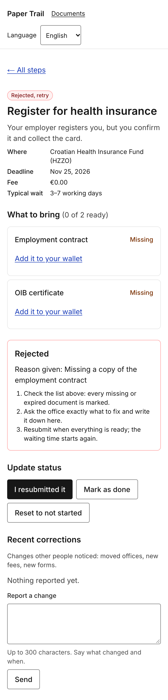
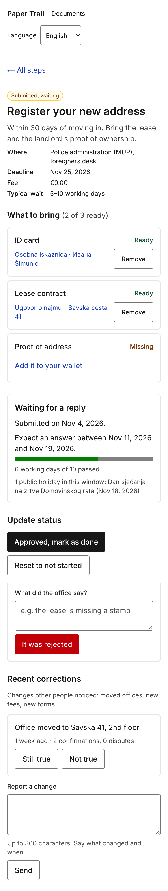
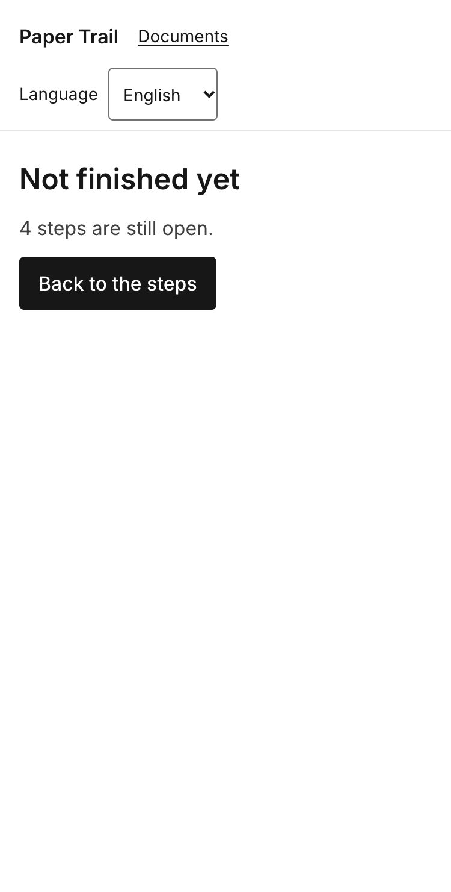

# 3. From wireframes to screens

## 3.1 Merged screen map

Numbers 01–10 are Maroje's Deliverable 1 set, 11–20 are Hlib's. The "wireframe no." is the sheet
number in that member's Deliverable 1; the application numbering in the README follows the
implemented screens, which is why some of Hlib's numbers shifted (see the last column).

| # | Screen in the application | From whose Deliverable 1 set | Wireframe no. | Changed since the wireframe? How? |
|---|---|---|---|---|
| 1 | Home (`/[locale]`) | Maroje | 01 | Welcome and entry point: one sentence, *Start a new journey*, *My documents* and shortcuts to existing journeys. The onboarding sequence of the wireframes (02) was folded into this one screen. |
| 2 | Pick a life event (`/events`) | Maroje | 03 | As designed: a card per life event with its summary and step count, *Start* creates the journey. The country of the journey is fixed to Croatia until the country picker (#17) exists. |
| 3 | Journeys list (`/journeys`) | Maroje | 09 | As designed, plus *Rename* and *Delete* with a confirmation dialog (needed for F3) and an empty state with a call to action. |
| 4 | Rename a journey (`/journeys/[id]/edit`) | Maroje | 10 | Reduced to the one setting the data model has: the name. An empty name falls back to the life event's name. |
| 5 | Documents wallet (`/documents`) | Hlib | 11 | As designed: every document in one list with type and *valid until*; "+ Scan new document" became *Add a document* because the web has no app-level camera. |
| 6 | Add a document (`/documents/new`) | Hlib | 12 | The camera-permission screen became a form with a file input that opens the camera on phones (`capture`); the permission dialog is the browser's own, so it could not be designed. |
| 7 | Reading state (inside 12 and the document page) | Hlib | 13 | "Reading your scan…" is announced while the upload runs and the loading skeleton shows while the page streams; it is a state of the form, not a separate route. |
| 8 | Document page with edit and delete (`/documents/[id]`) | Hlib | — (new) | Added for F3 (read, update, delete with confirmation): the scan, which steps use the document, an edit form and *Delete this document*. |
| 9 | Step requirements ("What to bring", on `/journeys/[id]/steps/[stepId]`) | Hlib | 14 | As designed, but attaching from the wallet is a picker, not automatic, and the *Continue* question was answered: the status buttons stay enabled, a missing document is a warning, not a block. |
| 10 | Steps overview (`/journeys/[id]/steps`) | Hlib (status) / Maroje (path) | 15 and Maroje's 05 | Maroje's "path" and Hlib's "step status" list merged into one screen: every step with its badge, deadline and expected reply date, progress bar on top. |
| 11 | Step status (buttons on the step page) | Hlib | 15 | The radio list became four buttons (*Start this step*, *I submitted it*, *It was rejected*, *Done*) that change the status immediately; the submitted date is set automatically. |
| 12 | Waiting for a reply (section on the step page) | Hlib | 17 | As designed, with real data: the "5–10 working days" of the template is turned into dates with the country's public holidays (Nager.Date) and a working-day progress bar; "Set reminder" became the automatic reminder date. |
| 13 | Rejected: what to fix (section on the step page) | Hlib | 16 | As designed: reason, "what to fix" note written by the user, *Fix and resubmit* (status back to in progress). "Ask for help" was dropped (no helper community in this release). |
| 14 | Recent corrections (section on the step page) | Hlib | 18 | As designed: corrections with *Still true* / *Not true* votes and a form to report one; shown on the step page instead of a separate route. |
| 15 | Offline mode (banner on every page) | Hlib | 19 | Became a state of every screen instead of one screen: a banner says what still works, forms are disabled with an explanation. Documents already opened stay readable. |
| 16 | Path complete (`/journeys/[id]/complete`) | Hlib | 20 | As designed: step and day summary, *Archive this journey*. "Download summary" was dropped; "Report what changed" links back to the corrections. |
| 17 | i18n evidence page (`/dev/i18n`) | — | — | Not a product screen: renders every formatter and plural form for the Part B evidence. |

## 3.2 What was dropped or merged, and why

- **Maroje's screens 02, 04, 05, 06, 07 and 08 were not built as separate screens.** The two-member
  team built the vertical slice first (events → steps → documents → waiting → complete) and the
  screens that the minimum requirements needed (F3 on journeys and documents). Of his set, 03, 09
  and 10 exist as designed; the path (05) and step details (06) are merged into Hlib's steps
  overview and step page, because a step's details, its requirements and its status are one
  object in the data model; the onboarding (02) is reduced to the home screen's intro sentence.
- **Find office (08) with REST Countries is not implemented.** Issue
  [#17](https://github.com/ma2357-dbk/paper-trail/issues/17) is open and assigned; the journey
  form has a `countryCode` column waiting for it, and until then every journey started from
  screen 03 is Croatian so that the public-holiday integration works. The product therefore has
  one external API (Nager.Date), not two.
- **Hlib's 12 (camera permission) and 13 (reading) are states, not screens.** On the web the
  camera permission dialog belongs to the browser; the reading state is a live-region message
  during upload.
- **Hlib's 19 (offline) became a banner** on every screen rather than one replacement screen,
  because a replacement screen would have hidden the documents the user came to show.
- **Dropped buttons:** "Ask for help" (16), "Set reminder" (17, replaced by the automatic reminder
  date), "Download summary" (20). None of them had a data source in this release.

## 3.3 Screens of the finished application

All screenshots at 375 × 740 CSS px, 2× scale, seed database, English.

| | |
|---|---|
| **Screen: 01 Home**  | **Screen: 03 Pick a life event**  |

*Figure 3.1 — implemented screens 01 and 03 (Maroje)*

| | |
|---|---|
| **Screen: 09 Journeys**  | **Screen: 10 Rename a journey**  |

*Figure 3.2 — implemented screens 09 and 10 (Maroje)*

| | |
|---|---|
| **Screen: 11 Documents wallet**  | **Screen: 12 Add a document**  |

*Figure 3.3 — implemented screens 11 and 12 (Hlib)*

| | |
|---|---|
| **Screen: 14 Document, edit and delete**  | **Screen: 18 Rejected, what to fix**  |

*Figure 3.4 — implemented screens 14 and 18 (Hlib)*

| | |
|---|---|
| **Screen: 17 Waiting for a reply**  | **Screen: 20 Path complete**  |

*Figure 3.5 — implemented screens 17 and 20 (Hlib)*
