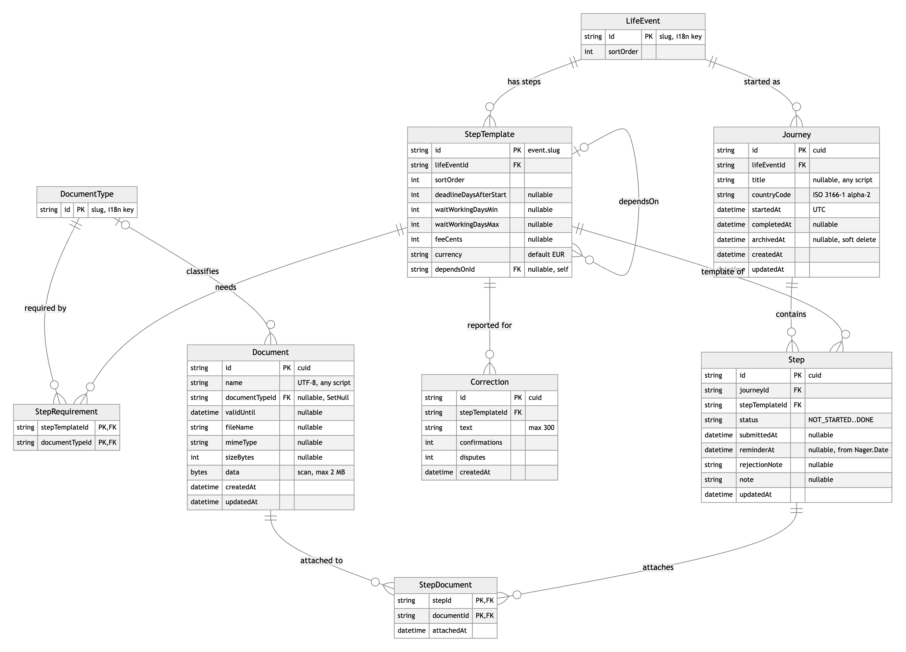
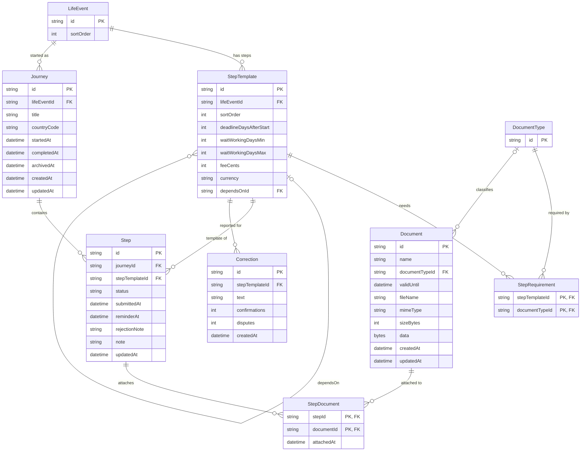
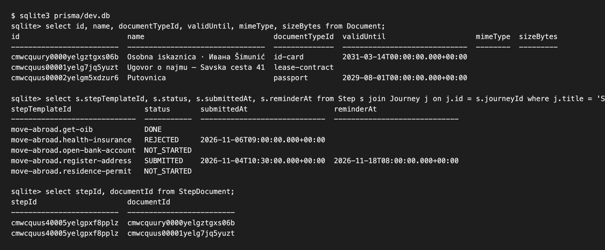
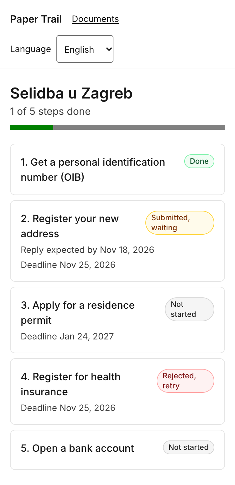

# 4. Database

## 4.1 Engine and justification

| | |
|---|---|
| **Database engine and version** | SQLite 3 (bundled with `better-sqlite3` 13), accessed through Prisma 7.10 with `@prisma/adapter-better-sqlite3`. |
| **Why this engine** | A reviewer gets a working, seeded database in two commands with nothing to install, the file is reproducible, and Prisma keeps the schema portable: switching to PostgreSQL for deployment is a change of `provider` and `DATABASE_URL`. |
| **Where the schema lives in the repository** | `prisma/schema.prisma` (9 models with comments), `prisma/migrations/20261111205634_init/migration.sql` (the SQL that creates the 9 tables, indexes and foreign keys). |
| **Migration tool / approach** | Prisma Migrate. A schema change produces a new folder in `prisma/migrations` which is committed and reviewed; `npm run db:migrate` runs `prisma migrate deploy`. `npm run db:reset` drops, re-migrates and re-seeds. |
| **How to load the seed data** | `npm run db:seed` runs `prisma/seed.ts`: 2 life events, 9 step templates with dependencies, 10 document types, 23 step requirements, 1 example journey ("Selidba u Zagreb", HR) with 5 steps in different statuses, 3 wallet documents (two attached to a step) and 1 correction. No real personal data; the sample person "Ивана Šimunić" mixes Cyrillic and Croatian diacritics on purpose. |
| **Character set / collation** | UTF-8 (`PRAGMA encoding` → `UTF-8`). Verified by storing and listing "Osobna iskaznica · Ивана Šimunić" and "Ugovor o najmu – Savska cesta 41" unchanged (figure 4.2). Timestamps are stored as ISO 8601 UTC and rendered in the `Europe/Zagreb` time zone by next-intl. No credentials in the repository: the path comes from `DATABASE_URL` in `.env` (`.env.example` committed). |

## 4.2 Entity-relationship diagram

*Figure 4.1 — entity-relationship diagram, generated from `prisma/schema.prisma` (source: `figures/erd.mmd`)*

Two layers: the **catalogue** (`LifeEvent`, `StepTemplate`, `DocumentType`, `StepRequirement`) is
seeded and its user-visible text lives in `messages/<locale>.json` under `catalog.*`, keyed by the
row id, so the catalogue is translatable without one row per language. **User data** (`Journey`,
`Step`, `Document`, `StepDocument`, `Correction`) is created through the interface.

## 4.3 Entities

| Entity / table | What it holds | Key relationships | Notes (indexes, constraints, soft delete …) |
|---|---|---|---|
| `LifeEvent` | A life event a journey can be started for (`move-abroad`, `start-university`). | 1 → many `StepTemplate`, 1 → many `Journey`. | `id` is a slug and doubles as the i18n key `catalog.events.<id>`. |
| `StepTemplate` | One administrative step of an event: order, deadline in days from the journey start, typical waiting time in working days, fee, and which earlier step it depends on. | many → 1 `LifeEvent`; optional self-relation `dependsOn` (the step that must be DONE first); 1 → many `StepRequirement`, `Step`, `Correction`. | `id` = `<event>.<slug>`; composite index `(lifeEventId, sortOrder)`; cascade delete with the event. |
| `DocumentType` | A kind of document (`passport`, `lease-contract` …). | 1 → many `StepRequirement`, 1 → many `Document`. | Slug id, i18n key `catalog.documentTypes.<id>`. |
| `StepRequirement` | Which document types a step needs (the "What to bring" list). | Join table `StepTemplate` ↔ `DocumentType`. | Composite primary key `(stepTemplateId, documentTypeId)`; cascade on both sides. |
| `Journey` | A user's run through one life event: optional free-text title, country (ISO 3166-1 alpha-2, used for the holiday calendar), start, completion and archive timestamps. | many → 1 `LifeEvent`; 1 → many `Step`. | `archivedAt` is a **soft delete** (archived journeys disappear from lists, data stays); index on `archivedAt`; `completedAt` is set when the last step becomes DONE. |
| `Step` | Progress on one step of a journey: status (`NOT_STARTED`, `IN_PROGRESS`, `SUBMITTED`, `REJECTED`, `DONE`), when it was submitted, the reminder date computed from Nager.Date, the office's rejection reason, a free note. | many → 1 `Journey` (cascade), many → 1 `StepTemplate`; 1 → many `StepDocument`. | Unique `(journeyId, stepTemplateId)` so a journey has each step once. Status is a validated string (`src/lib/stepStatus.ts`), not an enum, because SQLite has no enums and the set must stay translatable. |
| `Document` | A wallet document (Hlib's full-CRUD entity): name in any script, optional type, validity date, and the uploaded scan (`fileName`, `mimeType`, `sizeBytes`, `data`). | many → 1 `DocumentType` (`onDelete: SetNull` keeps the document if a type is removed); 1 → many `StepDocument`. | `data` is a `Bytes` column limited to 2 MB by the upload validation; stored in the DB so the seed and offline reading stay self-contained. Deleting a document cascades to its attachments and is confirmed in a dialog first. |
| `StepDocument` | A wallet document attached to a journey step. | Join table `Step` ↔ `Document`. | Composite primary key `(stepId, documentId)`; `attachedAt`; cascade on both sides. |
| `Correction` | A change reported by users for a step ("office moved to Savska 41") with confirmation and dispute counters. | many → 1 `StepTemplate` (cascade). | Index `(stepTemplateId, createdAt)` for the "recent corrections" list; text limited to 300 characters. |

## 4.4 Evidence that it works

| In the database | In the application |
|---|---|
|  |  |

*Figure 4.2 — persistence evidence: the `Document`, `Step` and `StepDocument` rows in `prisma/dev.db`
(sqlite3 CLI) and the same journey rendered on the step-status screen (16). The mixed-script names
round-trip unchanged.*

**One non-trivial operation.** Changing a step's status (`setStepStatus` in
`src/app/[locale]/journeys/[journeyId]/steps/actions.ts`) is more than an `UPDATE`:

1. It validates the new status against the allowed set and reads the step with its template.
2. For `SUBMITTED` it stores `submittedAt = now` and asks `estimateReplyWindow()` for the end of the
   typical waiting window, counting only working days of the journey's country (public holidays from
   Nager.Date, weekends from `workingDays.ts`); that date becomes `reminderAt`. `REJECTED` stores
   the office's reason; `DONE` clears the reminder; any other status resets all three fields.
3. It then counts the journey's steps that are not `DONE`; if none remain, `Journey.completedAt`
   is set (and cleared again if a step is reopened). That one query is what makes the
   "Path complete" screen (20) appear automatically.
4. After `revalidatePath` the user is redirected either back to the step or, when the journey
   just finished, to the completion screen. The two updates are sequential rather than wrapped
   in a transaction; with SQLite's single writer that is safe enough for this product, and it is
   noted here rather than hidden.

The step page itself loads the step, its template, the requirements with the document type, the
attached documents and the latest corrections in one `findUnique` with nested `include`, plus
one query for the wallet (to offer what can still be attached), so the screen costs two round trips
to SQLite.
