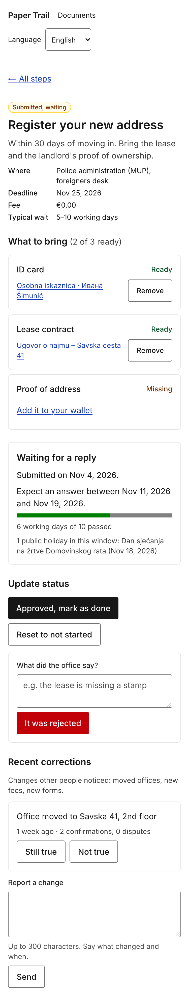
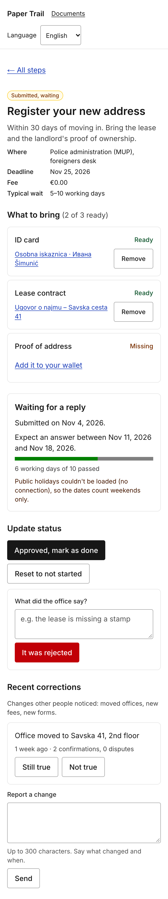

# 5. External REST API integration

## 5.1 The service

| | |
|---|---|
| **API name and provider** | Nager.Date public holiday API, by Nager (Tino Hager), open source. |
| **Documentation URL** | https://date.nager.at/Api (Swagger: https://date.nager.at/swagger/index.html) |
| **Why it is relevant to our topic** | Offices quote processing times in *working days* ("5–10 radnih dana"). Paper Trail turns that into real calendar dates on the "Waiting for a reply" screen (17) and into the reminder date stored on the step, which is only honest if public holidays of the journey's country are skipped. On 18 November 2026 (Dan sjećanja na žrtve Domovinskog rata) nothing is processed in Croatia, so the window for the seeded step ends on the 19th, not the 18th. |
| **Authentication (none / key / token) and where the secret lives** | None. The call is still made only from the server (`import "server-only"`), so a keyed replacement would not change the client. The only configuration is the optional `NAGER_DATE_BASE_URL` in `.env` (documented in `.env.example`), used to demonstrate failure states. |
| **Rate limits and terms we must respect** | Free for public use, no published hard quota; the provider asks for sensible use and caching. We cache every answer for 24 hours per (year, country) and never call the API from the browser, so a reviewer session makes at most 2 requests (current and next year). The project and its data are MIT-licensed; the holiday names shown come straight from the API. |
| **Attribution required by the provider?** | Not required for the data; we credit Nager.Date in the README and here. |
| **Where the integration lives in the code (file / module)** | `src/lib/nagerDate.ts` (`getPublicHolidays`, `estimateReplyWindow`), `src/lib/workingDays.ts` (pure working-day arithmetic, tested in `workingDays.test.ts`). Used by `src/app/[locale]/journeys/[journeyId]/steps/[stepId]/page.tsx` (screen 17) and `…/steps/actions.ts` (`setStepStatus`, sets `Step.reminderAt`). |

## 5.2 Endpoints used

| Endpoint | Method | What we send | What we use from the response | Where it appears in the UI |
|---|---|---|---|---|
| `https://date.nager.at/api/v3/PublicHolidays/{year}/{countryCode}` | GET | Only the year and the journey's ISO 3166-1 alpha-2 country code (e.g. `2026`, `HR`). **No personal data**: no names, dates of submission, documents or identifiers leave the server. Header `accept: application/json`, 5 s timeout. | `date` (to skip the day in the working-day count), `localName` (shown to the user, in the country's language), `name`, `global` / `counties` (regional holidays are excluded so a national estimate is not shortened by a county holiday). | Screen 17 *Waiting for a reply*: "Expect an answer between 11 Nov 2026 and 19 Nov 2026", the progress bar "6 working days of 10 passed", the list "1 public holiday in this window: Dan sjećanja na žrtve Domovinskog rata (18 Nov 2026)". Also the step overview (16) "reply by" line and the reminder date stored when a step is marked *submitted*. |

The same endpoint is called for the submission year and the following year, because a window that
starts in December crosses into January.

## 5.3 Failure handling

Every outcome of `getPublicHolidays()` is a typed result, `{ ok: true, holidays }` or
`{ ok: false, reason }`, so the screen never sees an exception. When the reason is set, the dates
are computed with weekends only and the screen says why (`steps.waiting.fallback.<reason>` in the
three locales). The user is never left with a blank panel or a stack trace.

| Failure mode | What the user sees | What the system does |
|---|---|---|
| **Network unavailable / offline** | The waiting window is still shown, computed from weekends only, with the sentence "Public holidays couldn't be loaded (no connection), so the dates count weekends only." Above it the global offline banner appears and submit buttons are disabled. | `fetch` throws → reason `offline`; `estimateReplyWindow` returns `fallback: "offline"` and an empty holiday set. Nothing is cached, so the next render retries. |
| **Request timeout** | "The holiday service took too long to answer, so the dates count weekends only." | `AbortSignal.timeout(5000)` aborts the request; `TimeoutError`/`AbortError` → reason `timeout`. The page still renders within the timeout because the holidays are awaited inside the Suspense boundary of the step page. |
| **Rate limit reached (429)** | "The holiday service is busy right now, so the dates count weekends only." | HTTP 429 → reason `rate-limited`; no retry storm, the 24 h cache means a successful answer is reused for every user and screen. |
| **Empty result set** | Normal screen without the holiday list: "Expect an answer between … and …", no "public holidays in this window" line. | An empty array is a valid answer (a country with no national holidays in the window); the working-day count simply skips only weekends. |
| **Malformed or unexpected response** | "The holiday service sent an unexpected answer, so the dates count weekends only." | Body is parsed and every element validated (`date` as `YYYY-MM-DD`, `localName` and `name` strings); anything else → reason `malformed`. Invalid JSON is caught the same way. |
| **Service down (5xx)** | "The holiday service is down, so the dates count weekends only." | Any non-OK status other than 404/429 → reason `server-error`. |
| **Invalid or expired key** | Not applicable: the API has no key. The equivalent case, an unknown or unsupported country code (HTTP 404, or a journey without a country) shows "No holiday calendar for this country, so the dates count weekends only." | Country code validated as two capital letters before calling; 404 → reason `unsupported-country`. |

## 5.4 Caching and data volume

Answers are cached by Next.js's fetch cache for **24 hours per (year, country)**
(`next: { revalidate: 86400 }`). Public holidays change a few times a year at most, and a reminder
date being a day off because a government announced a new holiday is acceptable for a day; the
window is recomputed from the cache on every render anyway. A typical reviewer session (open the
step overview, open the submitted step, mark something submitted) makes **2 external calls** on a
cold server (2026 and 2027 for HR) and **0** afterwards. One response for Croatia is about 2.7 KB
(14 holidays in 2026). Nothing is persisted from the API except the derived `reminderAt` date on the step.

## 5.5 Evidence

| Working state | Failure state |
|---|---|
|  |  |

*Figure 5.1 — external API in use (window 11–19 Nov 2026, holiday on 18 Nov listed) and when it is
not available (`NAGER_DATE_BASE_URL` pointed at a closed port: window 11–18 Nov, explanation shown,
rest of the screen unchanged).*
