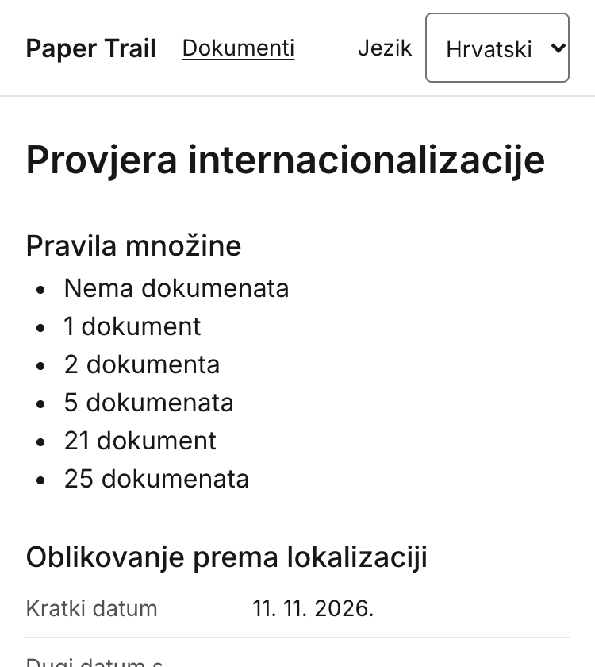
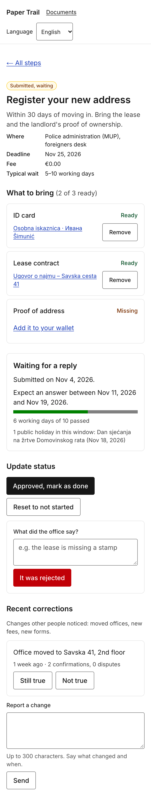
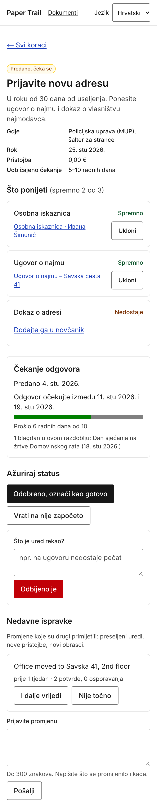
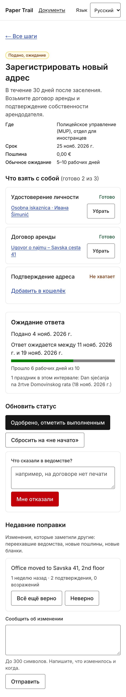

# 6. Internationalization and localization — sections 6.2, 6.3, 6.4, 6.7

(6.1, 6.5, 6.6 and 6.8 are Maroje's.)

## 6.2 How i18n is implemented

| | |
|---|---|
| **Library / framework used** | next-intl 4.15 on Next.js 16.4 (ICU MessageFormat via `intl-messageformat`, formatting via the platform `Intl.*` APIs). |
| **Where the translation files live** | `messages/en.json`, `messages/hr.json`, `messages/ru.json` in the repository root, one file per locale, under version control. |
| **File format and key naming convention** | JSON, nested objects. Keys are semantic and hierarchical by screen or domain: `documents.form.errors.fileTooLarge`, `steps.waiting.fallback.timeout`, `catalog.steps.move-abroad.register-address.title`. Catalogue text is keyed by the database row id so a step added to the seed gets its text in the three files, never in the table. Keys are never English sentences and never contain dots (next-intl uses them for nesting). The message types are generated from `en.json`, so `t("documents.fom.title")` is a TypeScript error and a hardcoded string in a component is caught in review. |
| **Number of translation keys** | 213 leaf keys in each file (parity checked with a script; CI would fail the build on a missing key in `en.json` because of the strict types). |
| **Fallback chain** | `<locale> → en`. `src/i18n/request.ts` deep-merges the English file under the requested locale's file, so a key missing from `hr.json` is served in English. |
| **How the locale is detected and persisted** | The locale is a **URL segment** (`/en/…`, `/hr/…`, `/ru/…`, `localePrefix: "always"`). `src/proxy.ts` (next-intl middleware) redirects `/` to the best match from the `NEXT_LOCALE` cookie, then the `Accept-Language` header, then the default `en`; every visit rewrites the cookie, so the choice survives a reload and a new tab. The IP address is never used. The switcher in the header swaps only the locale segment and keeps the current page. Unknown segments (`/de/...`) render the 404 page. |
| **How a missing key behaves** | Development: `onError` logs `[i18n] MISSING_MESSAGE …` to the server console and the screen shows `⚠ namespace.key` so it is impossible to miss. Production: the English fallback is rendered (see fallback chain); if even English lacks the key the message renders empty rather than as a raw key. |
| **How lang and dir attributes are set** | `src/app/[locale]/layout.tsx` renders `<html lang={locale} dir={getDirection(locale)}>`; `getDirection` in `src/i18n/routing.ts` returns `rtl` for locales in the `RTL_LOCALES` set (empty today, so `ltr` for en/hr/ru). Verified with axe-core on every screen 11–20: `lang="hr"` on `/hr/…`, `lang="en"` on `/en/…`. The `<option>` elements of the locale switcher carry their own `lang` so "Hrvatski" and "Русский" are pronounced correctly, and holiday names from Nager.Date (always in the country's language) are wrapped in `<span lang>` of that language (`holidayLanguage()` in `src/lib/nagerDate.ts`), found in the screen reader walkthrough (7.3). |

Other engineering rules from 6.2 of the brief, as implemented:

- No sentence is concatenated. "6 working days of 10 passed" is one message with two parameters
  (`{days, plural, …} of {max} passed`), and the holiday list is `Intl.ListFormat`, not `join(", ")`.
- No text in images: the only image in screens 11–20 is the user's own scan, with a localised
  `alt` ("Scan of {name}").
- Page titles, the skip link, `aria-label` of the navigation, the loading text of skeletons,
  validation errors, the 404 and error pages and the confirm-delete dialog are all translated.

## 6.3 Plural rules

Message definition (`i18nDemo.documentsCount`, the same pattern is used for `steps.waiting.elapsed`,
`steps.waiting.holidays`, `steps.corrections.votes`, `complete.stepsCount`, `complete.daysCount`,
`documents.list.count`):

```json
"en": "{count, plural, =0 {No documents} one {# document} other {# documents}}",
"hr": "{count, plural, =0 {Nema dokumenata} one {# dokument} few {# dokumenta} other {# dokumenata}}",
"ru": "{count, plural, =0 {Нет документов} one {# документ} few {# документа} many {# документов} other {# документа}}"
```

Rendered by the running product at `/<locale>/dev/i18n` (copied from the page, not typed):

| count | en | hr | ru |
|---|---|---|---|
| 0 | No documents | Nema dokumenata | Нет документов |
| 1 | 1 document | 1 dokument | 1 документ |
| 2 | 2 documents | 2 dokumenta | 2 документа |
| 5 | 5 documents | 5 dokumenata | 5 документов |
| 21 | 21 documents | 21 dokument | 21 документ |
| 25 | 25 documents | 25 dokumenata | 25 документов |

21 is the proof that the CLDR rules are used and not `n === 1`: Croatian and Russian treat 21 as
*one* (ends in 1 but not 11), 25 as *other* / *many*.



*Figure 6.1 — plural forms one / few / other, `/hr/dev/i18n`*

## 6.4 Locale-aware formatting

Every value is produced by next-intl's `useFormatter()` / `getFormatter()` (which wrap
`Intl.DateTimeFormat`, `Intl.NumberFormat`, `Intl.RelativeTimeFormat`, `Intl.ListFormat`) or by
`Intl.Collator`; the component never builds a string by hand. Values copied from `/en/dev/i18n`,
`/hr/dev/i18n`, `/ru/dev/i18n` on 2026-11-12 (reference instant 2026-11-11 14:05 UTC, time zone
`Europe/Zagreb`):

| What | en | hr | Third locale: **ru** | Formatted by |
|---|---|---|---|---|
| **Short date** | 11/11/26 | 11. 11. 2026. | 11.11.2026 | `format.dateTime(d, { dateStyle: "short" })` |
| **Long date with weekday** | Wednesday, November 11, 2026 | srijeda, 11. studenoga 2026. | среда, 11 ноября 2026 г. | `format.dateTime(d, { dateStyle: "full" })` |
| **Time** | 3:05 PM | 15:05 | 15:05 | `format.dateTime(d, { timeStyle: "short" })` — 12 h clock in en, 24 h in hr and ru |
| **Relative time ("3 days ago")** | 3 days ago | prije 3 dana | 3 дня назад | `format.relativeTime(then, now)` |
| **Large number** | 1,234,567 | 1.234.567 | 1 234 567 | `format.number(1234567)` — ru uses a narrow no-break space |
| **Decimal number** | 1,234.56 | 1.234,56 | 1 234,56 | `format.number(1234.56)` |
| **Percentage** | 26% | 26 % | 26 % | `format.number(0.256, { style: "percent" })` |
| **Currency** | €49.90 | 49,90 € | 49,90 € | `format.number(49.9, { style: "currency", currency: "EUR" })` — symbol position follows the locale; step fees on screens 15–16 use the same call with the template's `currency` |
| **List of three items** | ID card, Lease contract, and Proof of address | Osobna iskaznica, Ugovor o najmu i Dokaz o adresi | Удостоверение личности, Договор аренды и Подтверждение адреса | `format.list([...])` — Oxford comma in en, "i"/"и" without comma in hr/ru; the holiday list on screen 17 uses the same |
| **Sorted list of names with Č, Ć, Š** | Ana, Čedo, Ćiril, Cvita, Đuro, Šimun, Zoran | Ana, Cvita, Čedo, Ćiril, Đuro, Šimun, Zoran | Ana, Čedo, Ćiril, Cvita, Đuro, Šimun, Zoran | `[...names].sort(new Intl.Collator(locale).compare)` — Croatian collation puts Č, Ć after C and Đ after D; ASCII order would put all of them after Z |

Dates and times in the product are stored as UTC in SQLite (`DateTime` columns, ISO 8601) and
rendered in `Europe/Zagreb` through the same formatter (`timeZone` in `src/i18n/request.ts`), e.g.
"Submitted on Nov 4, 2026" / "Predano 4. stu 2026." / "Подано 4 нояб. 2026 г." on screen 17.

## 6.7 Direction and script

| | |
|---|---|
| **Right-to-left locale implemented?** | No. The third locale is Russian (Cyrillic, left-to-right). |
| **How direction is switched** | Ready but unused: `dir={getDirection(locale)}` on `<html>`, with `RTL_LOCALES` in `src/i18n/routing.ts` as the single place to add `ar` or `he`. |
| **Logical CSS properties used instead of left/right?** | Yes, throughout: Tailwind logical utilities `ps-*` / `pe-*` / `ms-*` / `text-start` are used instead of `pl` / `pr` / `ml` / `text-left` (e.g. the `<th scope="row" class="pe-4 text-start">` on the formatting table, `ps-6` on lists), so a future RTL locale mirrors without touching components. |
| **Which icons are mirrored, and which are deliberately not** | The product uses no icon font; the only directional glyph is the "←" in "← Back to documents" / "← All steps", which lives in the message string so an RTL translation would simply use "→". Check marks and the progress bar would stay unmirrored. |
| **How numbers and Latin names behave inside RTL text** | Not exercised (no RTL locale). The same mechanism that is exercised — the Unicode bidi algorithm handling mixed scripts — is what keeps "Osobna iskaznica · Ивана Šimunić" readable inside a Russian sentence and inside an English one. |
| **If not RTL: what script or line-breaking issue was handled instead** | **Mixed scripts in one line.** Document names, Croatian holiday names and office names come from the database or from the API in Latin script with diacritics (č ć đ š ž) and appear inside Cyrillic sentences in the Russian locale: "1 праздник в этом интервале: Dan sjećanja na žrtve Domovinskog rata (18 нояб. 2026 г.)". Two things had to be right: (1) the font — Inter is loaded with the `latin`, `latin-ext` and `cyrillic` subsets in every weight used, so there is no fallback-font mismatch between "Ивана" and "Šimunić" in the same name; (2) storage and transport — SQLite UTF-8, `Content-Disposition: inline; filename*=UTF-8''…` on the scan route so a file named in Cyrillic downloads with its name. **Line breaking:** Croatian and Russian both produce long words ("internacionalizacije", "Подтверждение"), so nothing in screens 11–20 assumes a single line: buttons are `inline-flex` with `min-h-11` and wrap, labels sit above fields, the step header is a `<dl>` that stacks on narrow screens, and `break-words` is on the document name heading so a long name without spaces cannot push the layout sideways (verified at 320 px, see 7.1 check 3). |

| English | Croatian | Russian |
|---|---|---|
|  |  |  |

*Figure 6.5 — the waiting screen (17) in three scripts; the mixed-script document name and the
Croatian holiday name appear unchanged inside Cyrillic text.*
