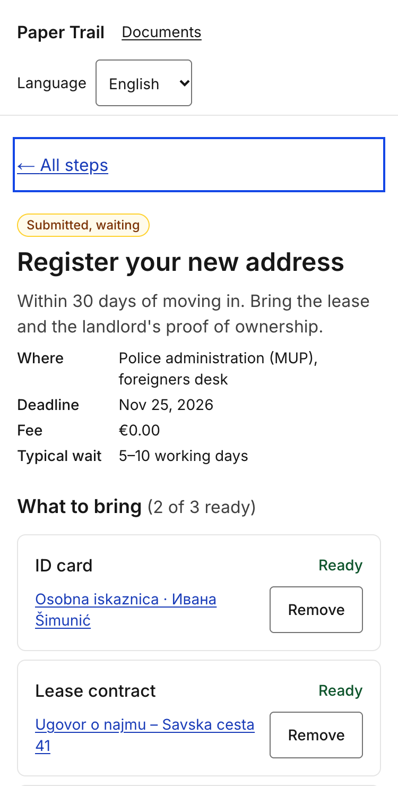
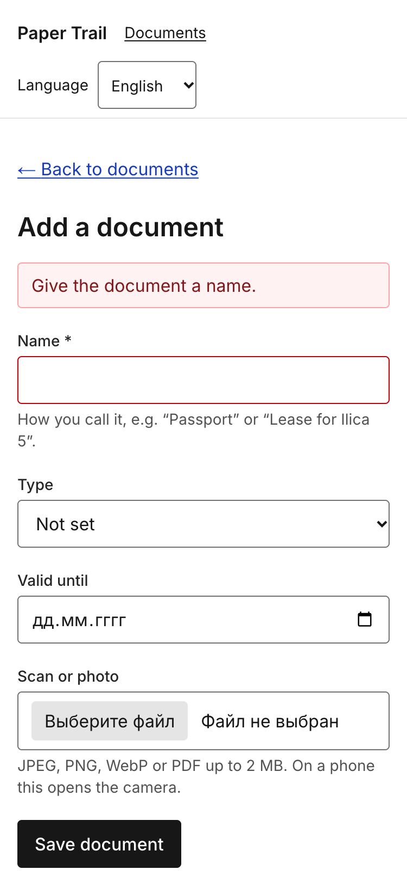
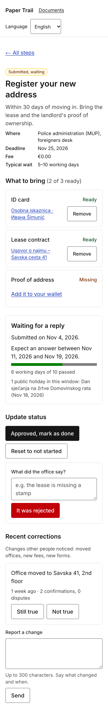
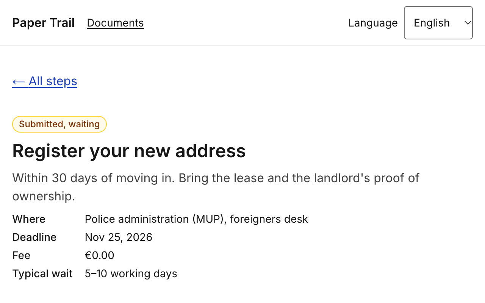
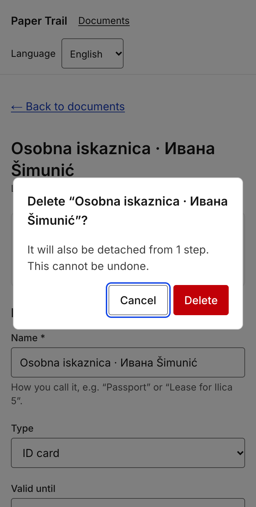

# 7. Accessibility report — screens 11–20 (Hlib)

Scope: documents wallet (11 list, 12 add/scan, 13 reading/loading state, 14 detail with edit and
confirmed delete), step requirements (15), step status (16), waiting for a reply (17), rejected
(18), recent corrections and offline (19), path complete (20). Run on 2026-11-12 against the seed
database with Chrome 157 (Playwright) at 375 × 740 CSS px; Maroje adds the same table for screens
01–10. Target: WCAG 2.2 AA.

## 7.1 The ten-minute check

| # | Check | Result | Issues found | Fixed? |
|---|---|---|---|---|
| 1 | Keyboard only — everything reachable and operable | **Pass** | Tab order recorded on every screen: skip link → "Paper Trail" → "Documents" → language select → page content in reading order (e.g. screen 17: back link, 2 document links, 2 *Remove* buttons, *Add it to your wallet*, 3 status buttons, rejection note, *It was rejected*, *Still true*, *Not true*, correction textarea, *Send*). All 8–18 controls per screen are real `<a>`, `<button>`, `<input>`, `<select>`, `<textarea>`; the delete confirmation is a native `<dialog>` opened with `showModal()` (focus moves to *Cancel*, Esc closes, focus is trapped by the browser). No keyboard trap found. The Next.js dev-tools badge is the last tab stop in development only. | n/a |
| 2 | Focus indicator always visible | **Pass after fix** | Content controls already had a 2 px blue-700 outline with 2 px offset (`focus-visible`). The header links and the language `<select>` relied on Chrome's default 1 px `auto` ring, which is visible but inconsistent and thin. The 4th tab stop inside the native date input (the calendar icon) shows no outline; that is Chrome's internal control. | Yes — `ui.focus` applied to the header links and the locale select (this PR). Date picker icon: browser-internal, not fixed. |
| 3 | 200 % zoom / 320 px width | **Pass after fix** | At 320 px every screen overflowed horizontally by 13 px: the "Language" label + select in the header did not fit beside the two navigation links (`scrollWidth` 333). At 1280 px and CSS zoom 200 % no overflow, no overlap, nothing hidden. | Yes — header is `flex-wrap`, the switcher drops to its own line below 350 px; re-measured `scrollWidth` = 320 on all six screens. |
| 4 | Automated scan | **Pass** | axe-core 4.14 (`wcag2a`, `wcag2aa`, `wcag22aa`, `best-practice`) on screens 11, 12, 12-with-error, 14, 14-dialog, 16, 17, 18, 20 and `/hr/dev/i18n`: **0 violations, 0 incomplete**, 37–44 passed rules per screen (landmarks, labels, `lang`, heading order, colour contrast, list semantics, button names, `aria-*` validity). | n/a |
| 5 | Colour contrast | **Pass after fix** | Measured from rendered colours: body text 17.9:1, muted text (neutral-700) 10.4:1, hint text (neutral-600) 7.8:1, link blue-800 8.8:1, primary button 17.9:1, danger button white on red-700 6.4:1, status badges 8.7–13.9:1, "Missing"/"Ready" labels 9.1:1 / 8.4:1, focus ring blue-700 on white 6.8:1. **Two failures:** placeholder text was 3.4:1 (Tailwind's default 50 % current colour, needs 4.5:1), and the border of inputs, textareas, the select and secondary buttons (neutral-400) was 2.6:1 against white, below the 3:1 minimum for component edges (1.4.11). Disabled buttons: white on neutral-400 = 2.6:1 (exempt under 1.4.3, logged anyway). | Both: yes — `placeholder:text-neutral-600` (7.8:1) and `border-neutral-500` (4.7:1). Disabled buttons: no, see 7.5 (#6). |
| 6 | Images and alt text | **Pass** | The only `` in these screens is the user's scan on screen 14, `alt="Scan of {document name}"`, localised. PDF uploads are a link, not an image. No decorative images; status is text, not icons. | n/a |
| 7 | Form labels and error messages | **Pass** | Every control has a `<label for>` (axe `label` rule and a DOM check: 0 unlabeled fields on 12, 14, 17, 18). Clicking a label focuses its field. Submitting the empty add-document form: `role="alert"` "Give the document a name.", the field gets `aria-invalid="true"` and `aria-describedby` pointing at the message; the correction form behaves the same ("Write what changed."). File too large / wrong type / invalid date each have their own translated message. Required fields are marked with text, not colour. | n/a |
| 8 | Heading order and lang attribute | **Pass** | One `<h1>` per screen, sections under `<h2>` with `aria-labelledby` (screen 17: h1 → "What to bring", "Waiting for a reply", "Update status", "Recent corrections"; screen 14: h1 → "Used in 1 step", "Edit", "Delete this document"). `<html lang>` is `en`/`hr`/`ru` per URL, `dir="ltr"`; `<option lang>` on the language names. Page `<title>` is translated (`%s · Paper Trail`). | n/a |
| 9 | Screen reader — one complete task | **Not yet run** | The VoiceOver walkthrough (add a document → attach it on screen 15 → mark submitted → read screen 17) is tracked as [#8](https://github.com/ma2357-dbk/paper-trail/issues/8). What is in place for it: `role="status"` live regions for the loading skeleton, the offline banner and the "saving…" state of every submit button; `role="alert"` for validation errors; a `<progress>` element with a text equivalent ("6 working days of 10 passed"); `aria-current="step"` on the active step in the overview. | Open |
| 10 | Target size, spacing and reduced motion | **Pass** | Every interactive element measured ≥ 44 × 44 CSS px (`min-h-11` on buttons, links, inputs and the select; smallest measured 44 px on all screens), with `gap-2`/`gap-3` spacing; the skip link is 1 × 1 px only while hidden and 40 px tall when focused. The only animation is the loading skeleton's pulse; with `prefers-reduced-motion: reduce` emulated, `animation-name` resolves to `none` on all skeleton rows (`motion-reduce:animate-none`, added in this PR). Nothing flashes. | Reduced motion: yes (this PR). |

## 7.2 Tools used

| Tool | Where it was run | Summary of result |
|---|---|---|
| axe-core 4.14.0 (injected via Playwright) | Screens 11, 12 (+ error state), 14 (+ delete dialog), 16, 17, 18, 20, `/hr/dev/i18n`; en and hr | 0 violations, 0 incomplete on every screen. |
| Playwright 1.65 + Chrome 157, scripted checks | Same screens at 375 px, 320 px and 1280 px @ 200 % | Tab order, focus outline per stop, bounding boxes of all interactive elements, `scrollWidth` vs viewport, heading list, `lang`/`dir`, unlabeled-control count, `animation-name` under reduced motion. Found the 320 px overflow and the thin header focus ring. |
| Contrast probe (`getComputedStyle` + canvas, WCAG 2.x formula) | 12, 14, 16, 17 | Ratios in 7.1 #5; found the placeholder and the input-border failures. |
| Chrome DevTools, manual | 12, 14, 17 | Label click → field focus; Esc closes the dialog; date input keyboard entry. |
| `npm run lint` (eslint-config-next incl. `jsx-a11y` rules) | whole `src/` | Clean. |

## 7.3 Screen reader walkthrough

Not performed yet — see 7.1 #9 and issue #8. Plan: VoiceOver on macOS Safari and iOS, task "add
*Dokaz o adresi* with a scan, attach it to *Register your new address*, mark the step submitted,
read the expected reply window". Expected weak spots to listen for: the native date input's
segments, whether the `<progress>` value is announced alongside the text, and whether the live
region on the add form ("Reading the scan…") is spoken once and not twice.

## 7.4 Contrast evidence

| Measured | Fixed |
|---|---|
| Placeholder "e.g. the lease is missing a stamp": `oklab(0.205 0 0 / 0.5)` on white = **3.41:1** (fail). Input border neutral-400 `oklch(70.8% 0 0)` on white = **2.58:1** (fail, 1.4.11). Disabled primary button: white on the same neutral-400 = **2.58:1** (exempt). Danger button: white on red-700 = **6.42:1**. Badge "Submitted, waiting": amber-900 on amber-50 = **8.73:1**. | Placeholder after `placeholder:text-neutral-600`: `lab(34.9 0 0)` on white = **7.81:1**. Input border after `border-neutral-500`: `lab(48.5 0 0)` on white = **4.74:1**. |
|  |  |

*Figure 7.1 — contrast checks: the measured values above come from the rendered page; the
screenshots show the focus ring (2 px blue-700, offset 2 px) on screen 17 and the error state of
the add form.*

Further evidence:  ·
 ·

## 7.5 Known accessibility issues we did not fix

| Issue | Who it affects | Severity | Why it is still open | Issue link |
|---|---|---|---|---|
| Unknown document / journey id renders the not-found screen but with HTTP status 200 (the page streams) | Search engines, link checkers; screen-reader users still get the "Not found" heading | Low | Fixing it means resolving the id before the Suspense boundary and giving up the static shell; postponed | [#5](https://github.com/ma2357-dbk/paper-trail/issues/5) |
| Disabled submit buttons (offline, or while saving) have 2.6:1 label contrast | Low-vision users reading a disabled label | Low (exempt under WCAG 1.4.3, but the offline hint next to the button is what makes the state understandable) | Needs a design decision on the disabled style shared with Maroje's screens | [#6](https://github.com/ma2357-dbk/paper-trail/issues/6) |
| Cold load without a network connection shows the browser's error page (no service worker); open pages stay readable and forms are disabled with an explanation | Everyone without connectivity, in particular inside government buildings | Medium | A service worker and offline page are a feature of their own; out of scope for this deliverable | [#7](https://github.com/ma2357-dbk/paper-trail/issues/7) |
| Screen reader walkthrough not yet done | Blind users; we do not know yet where the narration is unclear | Unknown until run | Time; automated and keyboard checks were done first | [#8](https://github.com/ma2357-dbk/paper-trail/issues/8) |
| Native `<input type="date">` is operated with Chrome's own segment controls, whose focus style we cannot change; the calendar icon shows no visible focus ring | Keyboard users on screen 12/14 | Low | Browser-internal; a custom date picker would cost more than it gives | — (noted here) |

## 7.6 Inclusive design decisions

- **Status is never colour alone.** Every step badge and requirement label is text ("Done",
  "Submitted, waiting", "Missing", "Ready"); the colour only reinforces it. Decided for colour-blind
  users, it also made the Russian and Croatian versions trivial because there was no icon legend to
  translate (curb-cut effect).
- **Native `<dialog>` for delete confirmation instead of a custom modal.** Focus management, Esc
  and the backdrop come from the browser; the dialog opens on *Cancel* so a slip on the keyboard
  cannot delete. A persona with a tremor and a persona in a hurry on the bus both benefit.
- **Offline is a state, not an error.** The banner explains what still works, and submit buttons are
  disabled with a visible and `aria-describedby` hint rather than failing silently. Designed for the
  "no signal in the MUP building" scenario, it also protects anyone on a flaky connection.
- **44 px targets everywhere, including links in lists.** The wallet entries and step cards are full-
  width links with `min-h-11`, chosen for touch, equally useful with a mouse and reduced motor
  control.
- **Working days, not calendar days.** The waiting screen translates "5–10 working days" into
  dates and says why a holiday moved them; cognitive load the user would otherwise carry alone, and
  an honest fallback message when the holiday service is down.
- **Any script, any name.** A single generously sized name field with no character restriction
  (Ивана Šimunić is the seed example), because the first thing bureaucracy does to people with
  "unusual" names is reject them.
