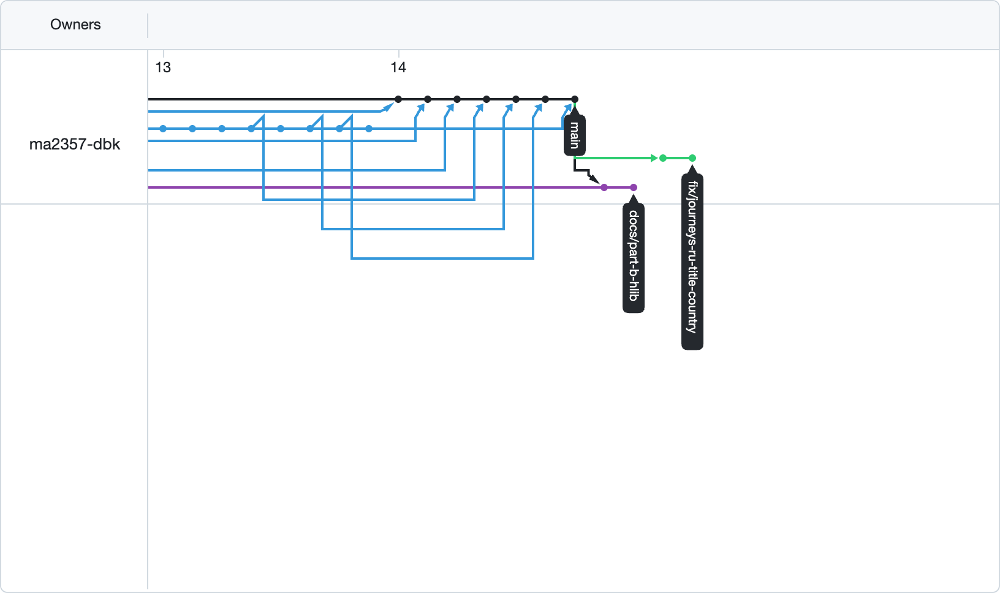
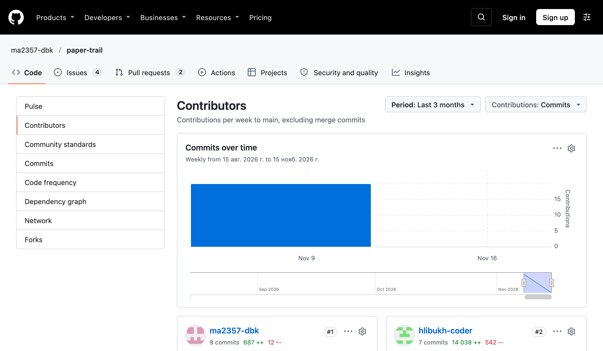

# 8. Git history and teamwork

## 8.1 Our branching model

`main` is the only long-lived branch and it is protected in the repository settings: a pull
request with at least one approving review is required, nobody can push to it directly (Hlib has
write access, not admin, so the rule applies to him; Maroje owns the repository). Every change is
made on a short-lived branch named after its purpose — `chore/project-scaffold`,
`feature/i18n-setup`, `feature/data-model`, `feature/documents-wallet`, `feature/croatian-strings`,
`feature/pick-life-event`, `feature/journeys-list`, `feature/journey-rename`, `docs/part-b-hlib`,
`fix/journeys-ru-title-country`, `docs/part-b-team` — opened as a pull request that links its
issue and lists the definition-of-done items, reviewed by the other member, and merged with a
merge commit (never squashed, so each member's commits stay attributed) by whoever is online once
it is approved. The merged branch is deleted. No `develop` branch: with two people and a
one-week build it would only have added a second place for conflicts.

Hlib's first four pull requests were **stacked** (each branch based on the previous one) so they
could be reviewed in order while he kept building; they were merged bottom-up and each was
re-targeted to `main` before the branch under it was deleted. **Conflicts** happened twice, both
in files both members touch (`README.md`, `messages/*.json`): they were resolved on the feature
branch by merging `main` into it ("merge: main into docs/part-b-hlib"), never by force-pushing.
Local git identities are set per repository to each member's real name and GitHub account, so
every commit is attributable.

## 8.2 Repository evidence

*Figure 8.1 — GitHub network graph on 15.11.2026: every feature branch leaves `main` and comes back
through a merge commit; the two purple/green branches on the right are the pull requests still
open at the time of the screenshot (#9, #19).*

*Figure 8.2 — Insights → Contributors on 15.11.2026 (commits to `main`, excluding merge commits):
all activity in the week of 9 November; ma2357-dbk 9 commits (+687 −12), hlibukh-coder 7 commits
(+14 038 −542, of which about 9 000 lines are `package-lock.json` from the scaffold).*

## 8.3 Commits per member per week

Counted with `git shortlog -sn --no-merges` per ISO week on `main` plus the open pull-request
branches on 15.11.2026 (merge commits in brackets). The development period in the brief is
19.10–14.11.2026, i.e. four weeks.

| Week | Member 1: Hlib Ukhovskyi (hlibukh-coder) | Member 2: Maroje Alamat (ma2357-dbk) |
|---|---|---|
| **W1** (19–25 Oct) | 0 — no repository yet | 0 — no repository yet |
| **W2** (26 Oct – 1 Nov) | 0 | 0 |
| **W3** (2–8 Nov) | 0 | 0 |
| **W4** (9–15 Nov) | 7 on `main` (+8 merges of reviewed PRs) and 10 on the branches of PRs #9, #19 and #20 (+2 merges of `main` into a branch) | 9 on `main` (initial commit, Croatian review, screens 03, 09, 10) |
| **Total** | 17 (+10 merges) | 9 |

Lines on `main`, excluding `package-lock.json`: Hlib +4 109 / −529, Maroje +466 / −12.

## 8.4 Pull requests

| PR # | Title | Author | Reviewer | What the review changed |
|---|---|---|---|---|
| [#1](https://github.com/ma2357-dbk/paper-trail/pull/1) | chore: scaffold Next.js app with next-intl and Prisma | Hlib | Maroje | Checked `.env.example`, `.gitignore` and `package.json` for secrets and scripts; approved. |
| [#2](https://github.com/ma2357-dbk/paper-trail/pull/2) | feat: next-intl routing with en, hr and ru locales | Hlib | Maroje | Checked the routing and the English fallback in `request.ts`, message files for all three locales; approved. |
| [#3](https://github.com/ma2357-dbk/paper-trail/pull/3) | feat: Prisma data model, initial migration and seed | Hlib | Maroje | Checked the schema against the screens, that the seed has no real personal data, and that the db scripts are documented; approved. |
| [#4](https://github.com/ma2357-dbk/paper-trail/pull/4) | feat: documents wallet, step screens 11–20 and Nager.Date | Hlib | Maroje | Checked document delete, form validation, the file route and the loading / error / not-found states; approved. |
| [#10](https://github.com/ma2357-dbk/paper-trail/pull/10) | fix(i18n): review and correct Croatian translations | Maroje | Hlib | Verified key parity (238/238), JSON validity, build and tests; wording left to the native speaker; approved. |
| [#11](https://github.com/ma2357-dbk/paper-trail/pull/11) | feat(events): pick a life event and start a journey | Maroje | Hlib | Ran the stack and drove screen 03 with keyboard and axe. Found that new journeys had no `countryCode` (so the holiday API only worked for the seed journey), the page title was generic, focus stayed at the top after *Start*, and `ru` strings were missing; approved with the fixes moved to PR #19 and #20 so the stack could land before the deadline. |
| [#12](https://github.com/ma2357-dbk/paper-trail/pull/12) | feat(journeys): journeys list with confirmed delete and empty state | Maroje | Hlib | Drove screen 09 (dialog focus, Esc, confirm, empty state, Cyrillic name, axe 0 violations); noted the missing page title and focus ring on the new header link; approved, fixes in #9 and #19. |
| [#18](https://github.com/ma2357-dbk/paper-trail/pull/18) | feat(journeys): rename a journey | Maroje | Hlib | Checked `maxLength` plus server validation, `role="alert"`, `aria-invalid` / `aria-describedby`, value kept after an error, route types; approved, title and `ru` strings in #19. |
| [#9](https://github.com/ma2357-dbk/paper-trail/pull/9) | docs: Part B drafts (2, 4, 5, 6.2–6.4, 6.7, 7) and accessibility fixes for screens 11–20 | Hlib | Maroje | Review requested 12.11, re-requested 14.11 after `main` was merged in. |
| [#19](https://github.com/ma2357-dbk/paper-trail/pull/19) | fix: Russian strings, page titles and a country for journeys started from screen 03 | Hlib | Maroje | The follow-up from the reviews of #11, #12 and #18; review requested 14.11. |
| [#20](https://github.com/ma2357-dbk/paper-trail/pull/20) | docs: complete Part B and accessibility fixes for screens 03, 09, 10 | Hlib | Maroje | This document; review requested 15.11. |

## 8.5 Honest account of the collaboration

**What did not work: the calendar.** The brief gives four weeks and a graded commit every week;
our repository was created on 11.11.2026 and every commit, review and merge is in the week of
9–15 November. The weekly-rhythm part of the grade is lost and the table in 8.3 says so.
Nothing was backdated: the push timeline on GitHub matches the commit dates. Within that week the
work was serialised rather than parallel: Hlib scaffolded the project, the locales, the data model
and his ten screens on 11–12 November (PRs #1–#4) so that there was something to review and build
on; Maroje reviewed those four PRs on 12–13 November, reviewed the Croatian strings as the native
speaker and built his three screens on 13 November (#10, #11, #12, #18); Hlib reviewed and merged
them on 14 November and opened the follow-ups. The load is uneven in lines (8.3) and the split
"first ten screens / last ten screens" from Deliverable 1 did not translate into independent
feature areas: the infrastructure everyone needs (i18n, database, shared components) was all in
Hlib's part.

**What worked.** Every change went through a pull request with a real review: Maroje's reviews
named what he checked (secrets, fallback, seed data, states); Hlib's reviews of Maroje's screens
ran the stack, drove the screens with the keyboard and axe, and found four defects that were fixed
in follow-up PRs (#19, #20) instead of blocking his merges on the deadline day. Issues were used
for his screens and for the accessibility findings (#5–#8, #13–#17), with assignees. Branch
protection on `main` was on from the first day and is why two PRs were still waiting for review
at the deadline rather than being self-merged. Conflicts were small (README, message files) and
were resolved by merging `main` into the branch. A mistake worth recording: merging #1 with
"delete branch" closed the stacked PR #2, because GitHub closes a PR whose base branch disappears;
the branch was restored from its SHA, the PR re-opened and re-targeted, and the rule "re-target
first, delete second" was followed for the rest of the stack.

**What we would set up differently.** Create the repository in week 1 with the scaffold and the
locale infrastructure, and split by feature (wallet, journeys, holidays, i18n) rather than by
screen number so both members have a vertical slice from the start; add a CI workflow running
`tsc`, `eslint`, the tests and `next build` on every PR so the reviewer does not have to; keep a
project board for the weekly plan instead of only issues.
